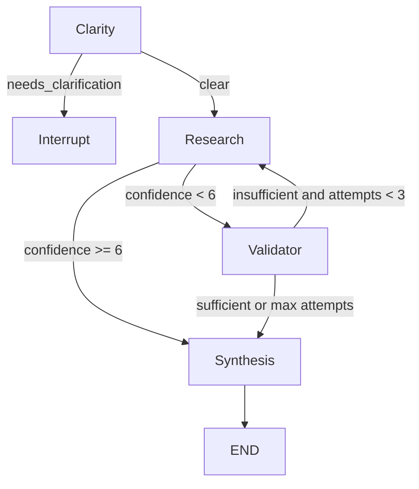

# Business Research Assistant (LangGraph)

A multi-agent research assistant that gathers business intelligence about companies. It uses LangGraph for orchestration, a clarity interrupt for ambiguous queries, and a FastAPI backend with a simple chat UI.

## Features

- Multi-agent workflow: Clarity, Research, Validator, Synthesis
- Human-in-the-loop clarification when a query is ambiguous
- Multi-turn conversation history for follow-up questions
- Web search integration via Tavily for research sourcing
- Lightweight web UI served by FastAPI

## Architecture

### Agents

1. **Clarity Agent**
   - Determines if a query is specific enough to research a company.
   - Outputs `clarity_status` as `clear` or `needs_clarification`.
   - Routes to interrupt when unclear.

2. **Research Agent**
   - Runs a web search and extracts relevant company facts.
   - Outputs `research_findings` and `confidence_score` (0-10).
   - Routes to Validator when confidence < 6.

3. **Validator Agent**
   - Checks if findings are sufficient for the query.
   - Outputs `validation_result` as `sufficient` or `insufficient`.
   - Loops back to Research for up to 3 attempts.

4. **Synthesis Agent**
   - Produces a structured response using research and conversation history.
   - Outputs `final_response`.

### Routing Flow



### State Model

The shared state tracks conversation history and agent outputs, including:

- `messages`: prior conversation messages
- `query`: current user query
- `resolved_query`: query rewritten with explicit company name
- `search_query`: query used for web search
- `clarity_status`, `clarification_question`
- `research_findings`, `confidence_score`
- `validation_result`, `attempt_count`
- `final_response`

## API

- `GET /` serves the chat UI
- `POST /chat` accepts a user message and returns the agent response

Example request:

```json
{
  "message": "What are Apple's latest financial results?",
  "session_id": null
}
```

Example response (normal flow):

```json
{
  "session_id": "9d2b2e7c-5b54-4db0-9a3c-9f12aaf44b2a",
  "response": "...",
  "status": "complete",
  "confidence_score": 8,
  "attempts": 1
}
```

Example response (clarification required):

```json
{
  "session_id": "9d2b2e7c-5b54-4db0-9a3c-9f12aaf44b2a",
  "response": "Which company are you asking about?",
  "status": "needs_clarification"
}
```

## Setup

1. Create a `.env` file based on `.env.example`.
2. Add API keys:

```
GEMINI_API_KEY=your_gemini_api_key_here
TAVILY_API_KEY=your_tavily_api_key_here
```

3. Install dependencies (example):

```
pip install fastapi uvicorn python-dotenv langgraph langchain-google-genai langchain-tavily
```

## Run

```
uvicorn main:app --reload
```

Then open http://127.0.0.1:8000/ in your browser.

## Notes

- Session state is stored in memory and resets on server restart.
- The FastAPI layer handles clarification interrupts and resumes the flow after the user responds.
- Research results depend on Tavily search coverage and may vary over time.
